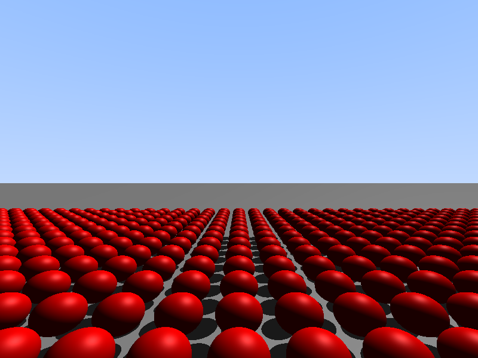

# Sheen

A fast, deliberately **biased** procedural raytracer for animation: analytical primitives, hard shadows, a flat BVH, and speed as the first design parameter rather than physical correctness.

The name is honest about the method — *sheen* is the silky highlight on hair, and the renderer earns it by cheating wherever it can afford to.



## Concept

- **Biased by design.** Caustics by splatting, hair by pre-integrated shading, volumetrics by fixed-step marching. The target is seconds per frame, not convergence in the limit.
- **Analytical, not tessellated.** A scene is primitives and their parameters, not a mesh: a `sphere_sweep` segment with a linearly varying radius is exactly a cone, so a ray hit is a quadratic equation, not a meshed approximation.
- **Animation first.** Deterministic seeds, temporal accumulation, motion vectors known analytically from the primitives themselves.

The plan is POV-Ray-like scene mathematics with the visual philosophy of old Blender Internal: fast, controllable, artist-facing.

## Status

| Feature | State |
| --- | --- |
| Sphere and plane intersections | done |
| Hard shadows (shadow rays, offset origin) | done |
| Materials: ambient + diffuse + Blinn-Phong specular | done |
| Flat BVH: 32-byte nodes, CPU build, GPU traversal | done |
| Planes kept out of the tree, checked only after it | done |
| 4x AA supersampling, on by default | done |
| `sphere_sweep` as cone sections, torus arcs for hair | planned |
| Cheap caustics, volumetrics | planned |
| Temporal accumulation | planned |

## Performance

Measured on a GTX 1080 Ti (`sm_61`), 800x600, 1000 spheres plus one plane, steady state. The first run after the GPU has been idle comes out 20-30% slower because the clocks have to ramp, so the figures below are medians of five runs of `tools/bench.cu`, which itself averages five frames per mode:

| Traversal | ms per frame, no AA | ms per frame, 4x AA |
| --- | --- | --- |
| Linear scan of every object | 10.4 | 55.7 |
| Flat BVH + separate plane check | 0.40 | 1.95 |

That is a **26x** speedup, with and without supersampling. Both traversals produce a **pixel-identical image — 0 differing pixels out of 480,000** — at both quality settings, and the benchmark checks that itself rather than leaving it to the eye.

4x AA is on by default in the render kernel and costs roughly 5x per frame. To measure without it, set `AA_SAMPLES` to 1 in `render_kernel.cu`; the benchmark prints both figures side by side.

A note on how the plane got here, because it is the step that produced this table: the infinite floor used to live inside the BVH, where its finite bounding box cut a seven-row sky band out of the horizon, and the O(N) scan needed to find it cost more than the tree saved — the speedup had fallen to 2.3x. Since the plane moved into its own array and is checked only after the tree misses, the horizon sits exactly on the geometric line and the speedup came back to 26x.

## Building

Requirements: Linux, a CUDA-capable GPU, CUDA Toolkit 12.x, CMake 3.25+.

```
cmake -S . -B build -DCMAKE_BUILD_TYPE=Release
cmake --build build -j
./build/sphere_test          # writes an 800x600 PNG and prints frame timing
```

The default CUDA compiler is `clang++` with `--no-offload-new-driver`, because nvcc 12.9 cannot parse the GCC 15 `libstdc++` headers shipped by the distribution this was developed on. To build with nvcc instead, pass `-DSHEEN_BACKEND=nvcc` and it will use the header shims in `shim/`.

Two toolchain notes worth knowing before you clone:

- CUDA 12.9 ships no arithmetic operators for `float3` here, so the few this renderer needs are defined in `types.h`.
- nvcc 12.9 already warns that offline compilation for architectures below `sm_75` will be removed in a future release, so `sm_61` support is on borrowed time.

Target architecture defaults to `sm_61`; override with `-DSHEEN_ARCH=...`.

## Benchmark

`tools/bench.cu` renders the same frame four times in one process — linear scan and BVH, each with and without 4x AA — prints the timings side by side and compares all the images pixel by pixel.

```
cd tools
clang++ -O2 -x cuda --cuda-path=/usr --no-offload-new-driver -Wno-unknown-cuda-version \
        --cuda-gpu-arch=sm_61 -I.. -L/usr/lib64 -lcudart bench.cu -o bench
./bench
```

## Layout

```
types.h, intersect.h, bvh.h, scene.h, render_kernel.*   the renderer itself
tests/         structure-size checks and the render test
src/           compiler smoke tests
tools/         the BVH benchmark
shots/         rendered frames
shim/          header shims, used only by the nvcc fallback
third_party/   vendored stb_image_write.h (v1.16, public domain) — writes the PNGs
incoming/      every code drop, in order, including those that failed to build
```

## How this is built

The code is written by an AI assistant from the roadmap above; every drop is transferred into the tree, compiled, run, and checked pixel by pixel before it is accepted. `incoming/` keeps the whole history of those drops, failures included, and `shots/` holds the frames that came out of them.

## License

MIT, see [LICENSE](LICENSE).
